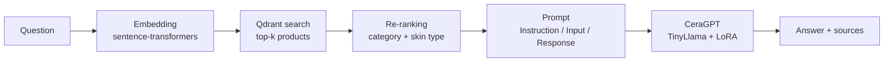
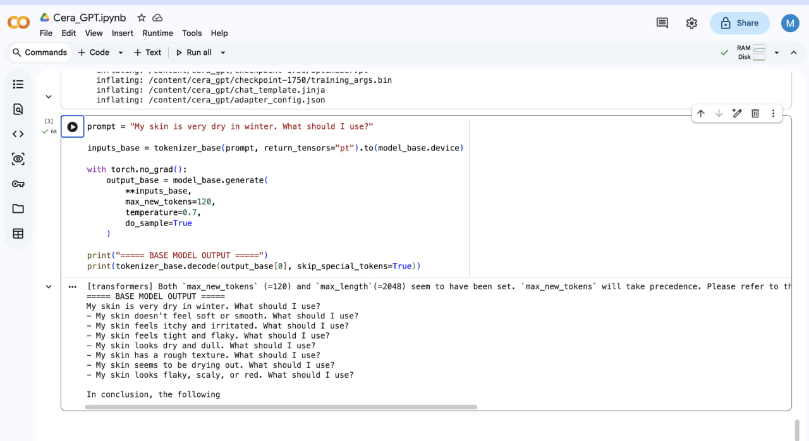
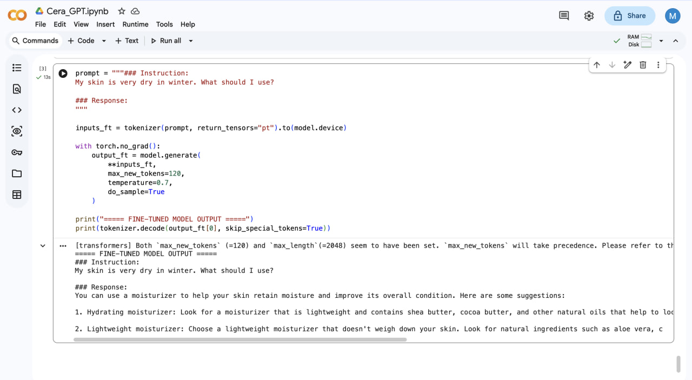

# CERA RAG

**CERA RAG — AI skincare assistant for CERANY, a K-beauty e-commerce store.**
Retrieval-Augmented Generation with a fine-tuned TinyLlama (CeraGPT).

The user asks a skincare question, the service finds the best-matching CERANY product in a vector database, and **CeraGPT** writes a short recommendation that is grounded in that product's description. The product it used is returned as the source.

---

## Features

- **FastAPI REST API**: `/health`, `/ingest-path` and `/query` endpoints with Pydantic request/response models.
- **Qdrant vector search** over CERANY product descriptions (Markdown files).
- **sentence-transformers embeddings** for questions and product chunks.
- **CeraGPT**: `TinyLlama/TinyLlama-1.1B-Chat-v1.0` plus a **LoRA adapter**, fine-tuned in **Google Colab** with **QLoRA (4-bit)**.
- **Category- and skin-type-aware re-ranking**: if the question mentions *serum* or *sunscreen*, or *dry* or *oily* skin, products whose `Category:` and `Skin type:` lines match are moved to the top.
- **Apple Silicon (MPS) acceleration**: `LLM_DEVICE=auto` picks `mps` (or `cuda`) when available and falls back to CPU otherwise.
- **Clean answers**: one source by default, a strict prompt, and cleaned-up endings.

---

## Architecture



1. The question is embedded with a sentence-transformers model.
2. Qdrant returns the closest product chunks.
3. The re-ranker boosts products that match the question's category (+0.15) and skin type (+0.10).
4. Results below `min_score` are dropped, and the top `MAX_SOURCES` go into the prompt.
5. CeraGPT generates the answer in the `### Instruction / ### Input / ### Response` format it was trained on.
6. The API returns the answer together with the product source(s).

---

## Tech stack

| Layer            | Technology                                             |
|------------------|--------------------------------------------------------|
| Language         | Python 3.11                                            |
| API              | FastAPI, Uvicorn                                       |
| Validation       | Pydantic v2, pydantic-settings                         |
| Vector database  | Qdrant (`qdrant-client`)                               |
| Embeddings       | sentence-transformers                                  |
| LLM              | TinyLlama-1.1B-Chat-v1.0 (Hugging Face `transformers`) |
| Fine-tuning      | PEFT / LoRA (r=8, alpha=16), QLoRA 4-bit, Google Colab |
| Acceleration     | PyTorch: MPS (Apple Silicon), CUDA, or CPU             |

---

## Project structure

```
cera_rag/
├── app/
│   ├── main.py                    # FastAPI app; wires services together at startup
│   ├── api/
│   │   └── routes.py              # /health, /ingest-path, /query
│   ├── core/
│   │   └── config.py              # Settings loaded from .env
│   ├── dto/
│   │   └── rag.py                 # Pydantic request/response models
│   └── services/
│       ├── embeddings_service.py  # sentence-transformers wrapper
│       ├── qdrant_service.py      # Qdrant collection, upsert and search
│       ├── llm_service.py         # TinyLlama + CeraGPT LoRA adapter, device selection
│       └── rag_service.py         # Ingestion, re-ranking, prompt building, answering
├── cera_gpt/                      # CeraGPT LoRA adapter (from Colab fine-tuning)
│   ├── adapter_config.json
│   ├── adapter_model.safetensors
│   ├── chat_template.jinja
│   ├── tokenizer.json
│   ├── tokenizer_config.json
│   └── README.md
├── cerany_products/               # Sample product knowledge base (Markdown)
│   ├── about_cerany.md
│   ├── routine_guide.md
│   ├── ceramide_barrier_cream.md
│   ├── niacinamide_10_serum.md
│   ├── mild_mineral_sun_cream.md
│   └── ...                        # 14 files in total
├── utils/
│   └── source_formatting.py       # Trims source text and adds product names
├── docs/                          # Screenshots (before/after fine-tuning)
├── requirements.txt
└── README.md
```

Every product file follows the same simple format, which the re-ranker relies on:

```markdown
# CERANY Ceramide Barrier Cream
Category: Moisturizer
Skin type: Dry, very dry, sensitive
Key ingredients: Ceramide NP, Panthenol, Shea Butter, Squalane
Price: 28,000 KRW (50 ml)

A rich cream that repairs the skin barrier ...
How to use: ...
```

---

## Setup

### 1. Create a virtual environment and install dependencies

```bash
python3.11 -m venv venv
source venv/bin/activate
pip install -r requirements.txt
```

### 2. Create a `.env` file

Create `.env` in the project root. The values below are placeholders, so replace them with your own:

```env
QDRANT_URL=https://your-cluster.qdrant.io
QDRANT_API_KEY=your_key
QDRANT_COLLECTION=cerany_products

EMBEDDING_MODEL=sentence-transformers/all-MiniLM-L6-v2
LLM_MODEL=TinyLlama/TinyLlama-1.1B-Chat-v1.0
LLM_ADAPTER_PATH=./cera_gpt
LLM_DEVICE=auto
LLM_MAX_NEW_TOKENS=150
LLM_TEMPERATURE=0

MAX_SOURCES=1
```

> `.env` is listed in `.gitignore`. Never commit real keys.

### 3. Run the server

```bash
uvicorn app.main:app --reload
```

The API runs at `http://127.0.0.1:8000`, and interactive docs are at `http://127.0.0.1:8000/docs`.

---

## API

### `GET /health`

```bash
curl http://127.0.0.1:8000/health
```

```json
{ "status": "OK" }
```

### `POST /ingest-path`

Loads every `.md`, `.txt` and `.json` file from a folder into Qdrant. Files are split into chunks, and each chunk gets a stable ID, so you can re-run ingestion safely.

```bash
curl -X POST http://127.0.0.1:8000/ingest-path \
  -H "Content-Type: application/json" \
  -d '{"path": "./cerany_products"}'
```

```json
{ "ingested": 14, "skipped": 0 }
```

### `POST /query`

```bash
curl -X POST http://127.0.0.1:8000/query \
  -H "Content-Type: application/json" \
  -d '{"question": "My skin is very dry in winter. Which CERANY cream should I use?"}'
```

```json
{
  "answer": "I recommend the CERANY Ceramide Barrier Cream. Its ceramides, panthenol and shea butter repair the skin barrier and lock in moisture, which helps with winter dryness. Apply it as the last step of your evening routine, and also in the morning before sunscreen in very dry weather.",
  "sources": [
    {
      "id": "3f6c1b2e-...",
      "text": "# CERANY Ceramide Barrier Cream\nCategory: Moisturizer\nSkin type: Dry, very dry, sensitive\n...",
      "score": 0.71,
      "metadata": {
        "path": "cerany_products/ceramide_barrier_cream.md",
        "product": "CERANY Ceramide Barrier Cream",
        "chunk": 0
      }
    }
  ]
}
```

*(The `id`, `score` and exact answer wording are illustrative. They change with the embedding model and data.)*

---

## Example results

| Question | Recommended product |
|----------|---------------------|
| My skin is very dry in winter. Which CERANY cream should I use? | **CERANY Ceramide Barrier Cream** |
| I have oily skin with big pores. What serum do you recommend? | **CERANY Niacinamide 10% Bright Serum** |
| Which sunscreen is good for sensitive skin? | **CERANY Mild Mineral Sun Cream SPF50+** |

---

## Fine-tuning (CeraGPT)

CeraGPT is a LoRA adapter on top of `TinyLlama/TinyLlama-1.1B-Chat-v1.0`. It was trained in Google Colab with **QLoRA**: the base model was loaded in 4-bit and only the small LoRA weights (r=8, alpha=16) were trained. The resulting adapter is in [`cera_gpt/`](cera_gpt/) and is loaded at startup through `LLM_ADAPTER_PATH`.

**Before fine-tuning, the base model just repeated the question. After fine-tuning, it answers as CeraGPT.**

| Before fine-tuning | After fine-tuning |
|--------------------|-------------------|
|  |  |

---

## Limitations

- **Small model**: with only 1.1B parameters, CeraGPT can still add facts that are not in the product files. Always check answers against the returned source.
- **English only**: prompts, training data and product files are in English.
- **Sample data**: the products in `cerany_products/` are sample data made for this project, not a real catalog.

---

## Author

**Madina Miriskakova (Dina)**
GitHub: [Dina-me10](https://github.com/Dina-me10)
